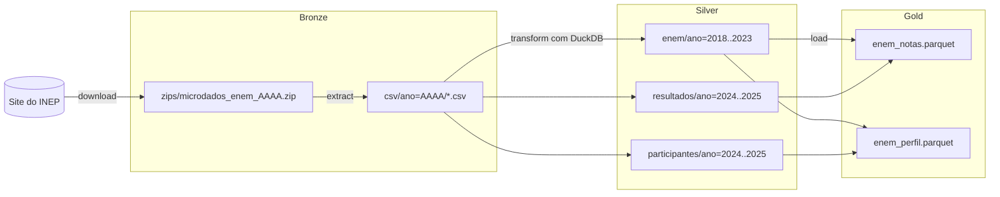

# Panorama ENEM - Pipeline de ETL

Pipeline que baixa os microdados do ENEM de 2018 a 2025 do site do INEP, extrai os CSVs,
converte para Parquet e junta tudo em arquivos menores que o app usa para calcular percentil e Z-Score.

## Arquitetura

Usamos a ideia de camadas bronze, silver e gold:



- **Bronze** (`data/bronze/`): o zip como veio do INEP e os CSVs da pasta `DADOS/` do zip.
- **Silver** (`data/silver/`): um Parquet por ano, só com as colunas que vamos usar, com tipos
  menores (ex.: `UTINYINT` para códigos, `DECIMAL(5,1)` para notas) e compressão ZSTD.
- **Gold** (`data/gold/`): os 8 anos juntos em dois arquivos, ordenados por ano e UF.
  - `enem_notas.parquet`: notas, presença, UF e escola. De 2018 a 2023 também traz
    `TIPO_ESCOLA`, `ESCOLARIDADE_PAI`, `ESCOLARIDADE_MAE` e `RENDA_FAMILIAR` na mesma linha
    (em 2024 e 2025 ficam vazias, ver abaixo).
  - `enem_perfil.parquet`: perfil e questionário completo, com as mesmas colunas harmonizadas.

Os tamanhos de cada camada estão em [docs/volumetria.md](docs/volumetria.md) e a comparação
entre formatos em [docs/benchmark.md](docs/benchmark.md).

## Como rodar

Com Docker (os dados ficam na pasta `./data`):

```bash
docker compose build
docker compose run --rm etl
```

Sem Docker, com o [uv](https://docs.astral.sh/uv/) (precisa ter o `unzip` instalado):

```bash
uv sync
uv run enem-pja3              # todos os anos
uv run enem-pja3 2023 2024    # só alguns anos
uv run python -m enem_pja3.benchmark
```

Se o pipeline parar no meio, é só rodar de novo: zips e CSVs que já existem são pulados.

## Testes

```bash
uv run pytest --cov=enem_pja3.transform --cov=enem_pja3.load --cov=enem_pja3.extract.extract_zips
```

Os testes usam CSVs pequenos criados na hora (em latin-1, como os do INEP) e conferem os tipos,
os valores nulos, o contrato de colunas e a harmonização do questionário.

## Arquivos

- `src/enem_pja3/config.py`: anos, link do INEP e pasta dos dados
- `src/enem_pja3/extract/download_zips.py`: download dos zips
- `src/enem_pja3/extract/extract_zips.py`: extração dos CSVs
- `src/enem_pja3/transform/transform.py`: CSV para Parquet (silver)
- `src/enem_pja3/load/load.py`: junta os anos na gold
- `src/enem_pja3/volumetria.py`: mede o tamanho de cada camada
- `src/enem_pja3/pipeline.py`: roda tudo em sequência

## Problemas que encontramos nos dados

- **LGPD.** Desde a edição 2020 o INEP usa um "modelo simplificado" dos microdados: sem código da
  escola, com faixa etária no lugar da idade e sem município de residência. Os arquivos de 2018 e
  2019 que baixamos já vêm assim. Até 2023 perfil e nota continuam na mesma linha.
- **Formato mudou em 2024.** Até 2023 era um CSV só por ano. Em 2024 e 2025 são dois:
  `PARTICIPANTES` (perfil e questionário) e `RESULTADOS` (escola e notas), e não tem coluna
  que ligue um ao outro. Então só dá para cruzar nota com perfil socioeconômico de 2018 a 2023.
- **Questionário muda de um ano para outro.** 2018 tem 27 perguntas, 2019 a 2023 têm 25 e
  2024/2025 têm 23. Exemplo: a renda da família é a `Q006` até 2023 e a `Q007` depois (em 2024 a
  `Q006` virou "Você possui renda?"). O tipo de escola é o `TP_ESCOLA` até 2023 e a `Q023` depois.
  Por isso a gold tem colunas com nome único (`RENDA_FAMILIAR`, `TIPO_ESCOLA`...).
- **Códigos do `TP_ESCOLA` mudam.** Em 2018, 3 = exterior e 4 = privada. Em 2019 e 2020,
  3 = privada e 4 = exterior. De 2021 em diante só existem 1, 2 e 3. A conversão está no `load.py`.
- **Certificado do site do INEP.** O servidor não manda o certificado intermediário e o
  `requests` dá erro de SSL. Em vez de desligar a verificação, salvamos esse certificado em
  `src/enem_pja3/certs/`.
- **Zip de 2025.** O `RESULTADOS_2025.csv` está compactado em Deflate64, que o Python não abre.
  Para esse arquivo usamos o `unzip` do sistema.
- **Memória.** Sem limite, o DuckDB passou de 20 GB de RAM ao montar a gold e o processo foi
  morto pelo sistema. Colocamos limite de 4 GB; o que passar disso ele grava em disco.
- **Leitura do CSV em paralelo.** Com encoding latin-1, a leitura em paralelo do DuckDB às vezes
  misturava duas linhas e dava erro. Lendo em série o problema não acontece.
